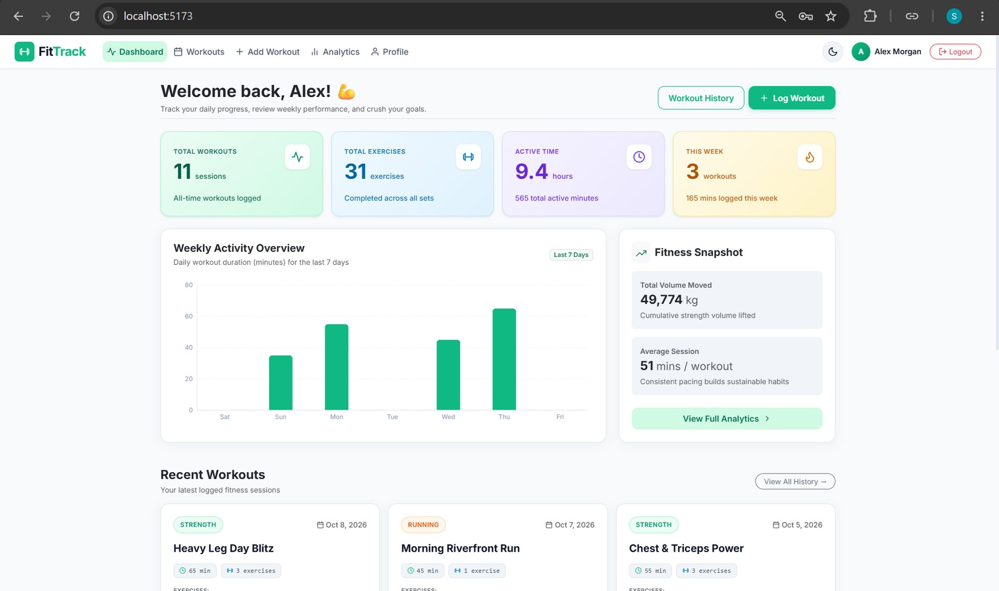
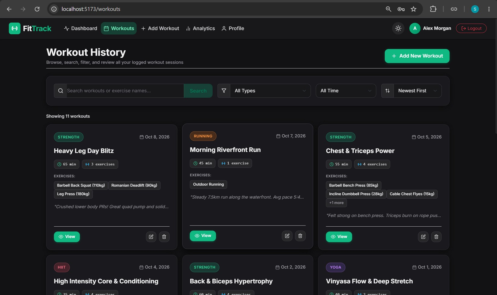
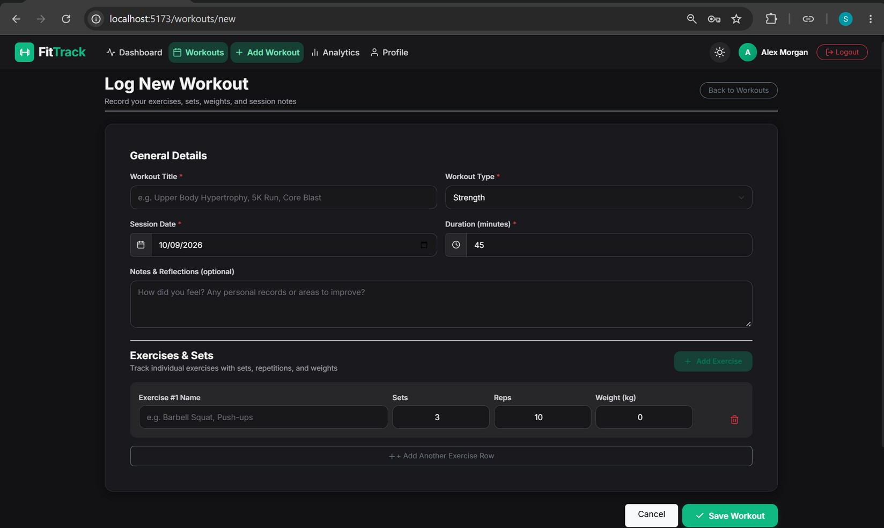
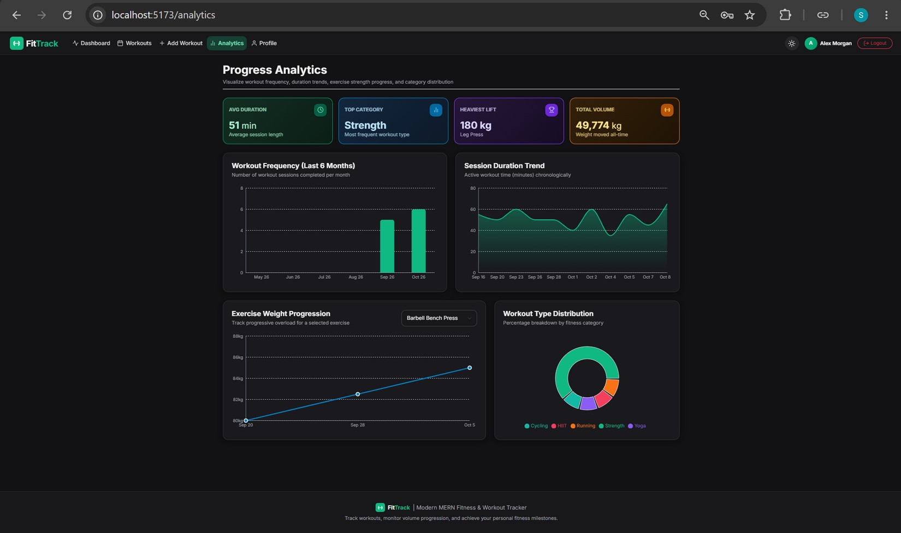
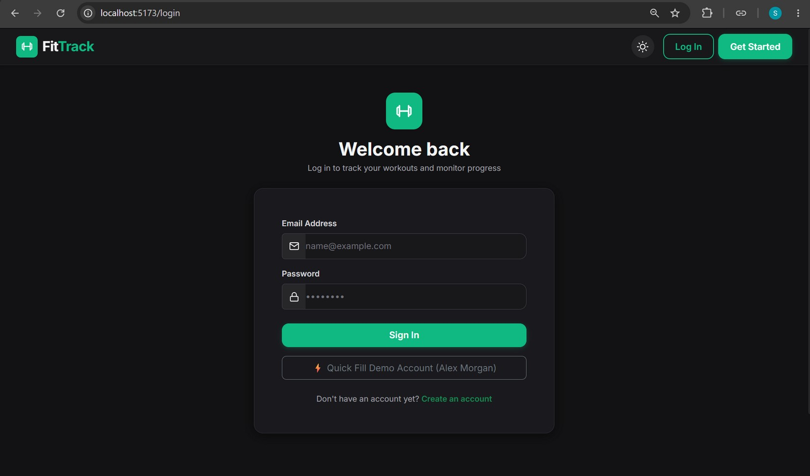
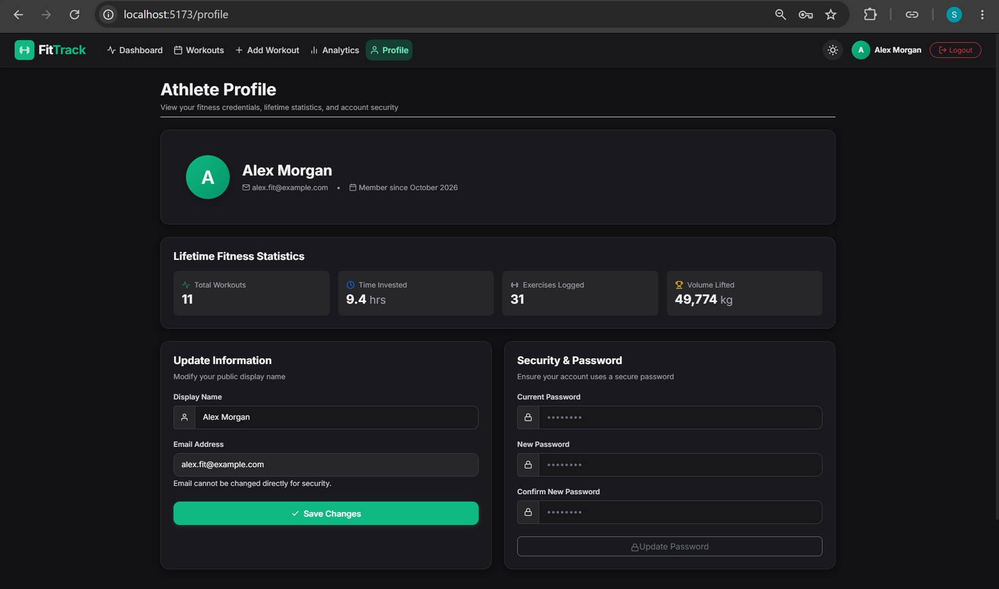

# 🏋️ FitTrack - MERN Workout & Fitness Tracker

FitTrack is a modern, responsive full-stack fitness and workout tracking web application built with the **MERN stack** (MongoDB, Express.js, React + Vite, Node.js). It features a clean, light-themed aesthetic with pastel statistic cards, vibrant fitness green buttons, interactive progression charts powered by Recharts, and complete user data isolation.

---

## 🖼️ Screenshots

| Dashboard | Workout History |
|---|---|
|  |  |

| Log Workout | Progress Analytics |
|---|---|
|  |  |

| Login | Athlete Profile (dark theme) |
|---|---|
|  |  |

---

## 📸 Design & UI Philosophy

- **Light & Dark Themes:** A one-click sun/moon toggle switches the whole app (and charts) between a light theme (white `#ffffff` backgrounds, light-gray `#f1f5f9` sections) and a dark theme; the choice is remembered.
- **Vibrant Fitness Accents:** Green action buttons (`#10b981`), badges, and interactive focus states.
- **Pastel Statistic Cards:**
  - 🌿 **Mint Pastel:** Total Workouts
  - 💧 **Sky Blue Pastel:** Total Exercises Completed
  - 🔮 **Lavender Pastel:** Active Time Invested
  - 🍯 **Amber Pastel:** Workouts This Week
- **Clean Architecture:** Strict avoidance of heavy icon libraries (uses handcrafted vector SVGs), avoidance of Tailwind CSS (clean Bootstrap 5 + custom CSS), and avoidance of Axios (uses modern native `fetch()`).

---

## 🚀 Key Features

1. **Authentication & Security:**
   - User registration and login with JWT (JSON Web Tokens).
   - Password hashing using `bcryptjs` with salt rounds.
   - Protected client-side routes with automatic token persistence in `localStorage`.
   - Strict MongoDB user data isolation ensuring each user only accesses their own records.

2. **Dashboard:**
   - 4 pastel statistic cards displaying lifetime workouts, exercises, total duration, and this week's frequency.
   - **Weekly Activity Chart:** Daily workout duration and session counts over the last 7 days.
   - Fitness snapshot cards for total cumulative volume lifted and average session duration.
   - Recent workouts feed with one-click detailed breakdown modals.

3. **Workout Management (CRUD):**
   - **Log Workout:** Name, session date, workout category (Strength, Cardio, HIIT, Yoga, Running, Cycling, Bodyweight, Other), duration in minutes, and session reflections/notes.
   - **Dynamic Exercises Builder:** Add or remove exercises on the fly with custom sets, reps, and weights.
   - Real-time live calculation of total estimated volume (Sets × Reps × Weight).
   - **View Workout Modal:** Detailed table showing set breakdowns, weights, subtotal volume, and notes.
   - **Edit & Delete Workouts:** Modify logged workouts or safely delete them with confirmation dialogs.

4. **Workout History & Filtering:**
   - Instant search across workout names, notes, and individual exercise names.
   - Filter by workout category (Strength, Cardio, HIIT, Running, etc.).
   - Filter by timeframe (All Time, Past 7 Days, Past 30 Days, Past Year).
   - Sort by Date (Newest / Oldest First), Duration (High to Low / Low to High), or Name (A-Z).
   - Active filter tags with single-click reset.

5. **Progress Analytics (Recharts):**
   - **Workout Frequency:** Monthly workouts completed over the past 6 months (Bar Chart).
   - **Session Duration Trend:** Chronological progression of workout duration in minutes (Area Chart with gradient).
   - **Exercise Weight Progression (Progressive Overload):** Select any logged exercise from a dynamic dropdown to view weight progression over time (Line Chart with tooltips).
   - **Category Distribution:** Proportional breakdown of workout types (Donut / Pie Chart with color-coded legend).
   - Milestone highlights: Average duration, top workout category, heaviest lift recorded, and total weight moved.

6. **Athlete Profile:**
   - Overview of user credentials, member since date, and lifetime fitness totals.
   - Form to update user display name.
   - Secure password change form with current password verification.

---

## 🛠️ Tech Stack

| Layer | Technology |
|---|---|
| **Frontend** | React 19, Vite 8, Bootstrap 5, Custom CSS, React Router DOM 7, Recharts 3 |
| **Backend** | Node.js, Express.js 4, MongoDB, Mongoose 8, JWT, bcryptjs |
| **Networking** | JavaScript `fetch()` API with Vite dev proxy |
| **Database** | MongoDB (with Mongoose schemas & virtuals) |

---

## 📁 Project Structure

```text
├── client/                     # Frontend React + Vite application
│   ├── public/
│   │   └── favicon.svg         # SVG dumbbell favicon
│   ├── src/
│   │   ├── components/         # Reusable UI components
│   │   │   ├── ConfirmModal.jsx
│   │   │   ├── Footer.jsx
│   │   │   ├── Icons.jsx       # Handcrafted SVG vector icons (no icon library)
│   │   │   ├── Navbar.jsx      # Responsive navigation with user badge
│   │   │   ├── ProtectedRoute.jsx
│   │   │   ├── StatCard.jsx    # Pastel statistic card
│   │   │   ├── WorkoutCard.jsx
│   │   │   └── WorkoutModal.jsx
│   │   ├── context/
│   │   │   └── AuthContext.jsx # Auth state, token handling & fetch API methods
│   │   ├── pages/
│   │   │   ├── Analytics.jsx   # 4 Recharts progress visualizations
│   │   │   ├── Dashboard.jsx   # Welcome metrics, weekly bar chart, recent workouts
│   │   │   ├── Login.jsx       # Login form with quick demo autofill
│   │   │   ├── NotFound.jsx    # Clean 404 handler
│   │   │   ├── Profile.jsx     # Profile updates & lifetime fitness stats
│   │   │   ├── Register.jsx    # User registration
│   │   │   ├── WorkoutForm.jsx # Add & Edit workout with dynamic exercises
│   │   │   └── Workouts.jsx    # Workout history, search, filters & sort
│   │   ├── App.jsx             # Router and layouts
│   │   ├── index.css           # Light/dark theme variables & custom styles
│   │   └── main.jsx            # React root with Bootstrap
│   ├── .env.example
│   ├── package.json
│   └── vite.config.js          # Vite config with /api proxy to port 5000
│
├── server/                     # Backend Express REST API
│   ├── config/
│   │   └── db.js               # Mongoose database connection
│   ├── controllers/
│   │   ├── analyticsController.js
│   │   ├── authController.js
│   │   ├── dashboardController.js
│   │   ├── profileController.js
│   │   └── workoutController.js
│   ├── middleware/
│   │   └── auth.js             # JWT verification middleware
│   ├── models/
│   │   ├── User.js             # User schema with bcrypt pre-save hook
│   │   └── Workout.js          # Workout schema with exercises subdocuments
│   ├── routes/
│   │   ├── analyticsRoutes.js
│   │   ├── authRoutes.js
│   │   ├── dashboardRoutes.js
│   │   ├── profileRoutes.js
│   │   └── workoutRoutes.js
│   ├── .env.example
│   ├── package.json
│   ├── seed.js                 # Realistic demo data seeder
│   ├── server.js               # Express application entrypoint
│   └── test-api.js             # Automated API integration test suite
│
├── .gitignore
├── package.json                # Root convenience scripts
└── README.md
```

---

## ⚡ Quick Start & Installation

### Prerequisites
- [Node.js](https://nodejs.org/) (v18+)
- A free [MongoDB Atlas](https://www.mongodb.com/atlas) cluster (the app connects to Atlas only; there is no local MongoDB fallback)

### 1. Installation

```bash
# Server setup
cd server
npm install

# Client setup
cd ../client
npm install
```

### 2. Environment Variables Configuration

In `server/.env`:
```env
PORT=5000
MONGODB_URI=mongodb+srv://<username>:<password>@<cluster-host>/fittrack?retryWrites=true&w=majority
JWT_SECRET=your_jwt_secret_here
NODE_ENV=development
```
> `JWT_SECRET` is required; the server exits at startup if it is missing. Use a long random string and never commit your `.env` file.

### 3. Seed Demo Data (Optional but Recommended)

Populate realistic workouts (Strength, Running, HIIT, Yoga, Cycling) with progressive overload data:
```bash
# From workspace root:
npm run seed

# Or from server directory:
node server/seed.js
```

**Pre-seeded Demo User:**
- **Email:** `alex.fit@example.com`
- **Password:** `password123`
*(A quick one-click autofill button is also available on the Login screen)*

### 4. Running the Application

In terminal 1 (start backend API on port 5000):
```bash
npm run server
```

In terminal 2 (start frontend on port 5173):
```bash
npm run client
```

Open your browser at **`http://localhost:5173`**.

---

## 📡 API Reference

All protected endpoints require `Authorization: Bearer <token>` in the header.

| Method | Endpoint | Access | Description |
|---|---|---|---|
| `POST` | `/api/auth/register` | Public | Register new user account |
| `POST` | `/api/auth/login` | Public | Authenticate user & receive JWT |
| `GET` | `/api/auth/me` | Private | Retrieve current user profile |
| `PUT` | `/api/auth/profile` | Private | Update user display name |
| `PUT` | `/api/auth/password` | Private | Change password with current password verification |
| `GET` | `/api/workouts` | Private | Get workouts with search (`q`), `type`, date range, and sort |
| `GET` | `/api/workouts/:id` | Private | Get single workout details |
| `POST` | `/api/workouts` | Private | Create new workout with exercises |
| `PUT` | `/api/workouts/:id` | Private | Update existing workout |
| `DELETE`| `/api/workouts/:id` | Private | Delete workout |
| `GET` | `/api/dashboard` | Private | Get dashboard totals, weekly chart data & recent workouts |
| `GET` | `/api/analytics` | Private | Get frequency, duration trends, exercise progress & distribution |
| `GET` | `/api/profile` | Private | Get athlete lifetime stats and totals |
| `GET` | `/api/health` | Public | API health check & uptime status |

---

## 🧪 Testing

An automated integration test suite is included in `server/test-api.js`. It tests:
1. User registration & JWT generation
2. User authentication (login)
3. Workout creation with multiple exercises
4. Filter by type & full-text search
5. Workout update & deletion
6. User data isolation (ensuring User B cannot view or modify User A's data)
7. Dashboard metrics aggregation
8. Analytics calculation

To run the tests:
```bash
npm run test:api
```

---

## 👤 Author

**Shubham Jindal** — B.E. CSE, Chandigarh University.

Licensed under MIT.
